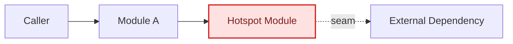
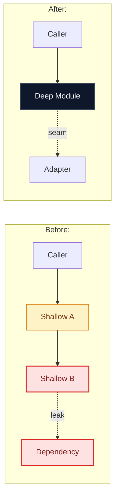

# Improve codebase architecture

Surface substantive architectural friction and propose **deepening opportunities** that turn shallow modules into deep ones for testability and AI-navigability. Keep repository files unmodified during exploration and reporting.

Use the exact vocabulary from [`codebase-design`](../codebase-design/SKILL.md) (**module**, **interface**, **implementation**, **depth**, **seam**, **adapter**, **leverage**, **locality**) rather than substitutes like "component", "service", "API", or "boundary". Ground domain names in `GLOSSARY.md` (and linked context glossaries), and respect decisions in `ARCHITECTURE.md` (and linked architecture guides and ADRs).

## Process

### 1. Explore subsystems deeply

1. **Load design rules and repository context.** Read `codebase-design` and [`DEEPENING.md`](../codebase-design/DEEPENING.md) for depth and dependency rules. Read `GLOSSARY.md` and `ARCHITECTURE.md`, then load the linked context glossaries, architecture guides, and ADRs covering the target scope.
2. **Set thorough scope.** If the user named a module, subsystem, or pain point, include it together with its callers and tests. Otherwise, check recent source churn (`git log -n 100 --name-only --pretty=format: -- apps packages site scripts`) and combine high-churn areas with the major subsystems in `ARCHITECTURE.md` so the scan covers real architectural boundaries rather than collapsing onto one small folder.
3. **Inspect full modules, callers, and tests.** Fan out parallel read-only subagents across subsystems when scanning broadly (or inspect one subsystem thoroughly in a fresh subagent). Read complete module implementations, call sites, and tests rather than skimming headers or sorting for tiny files, looking for:
   - Domain concepts fragmented across files that force jumping to trace one flow
   - Shallow modules whose interface approaches their implementation in complexity
   - Helpers extracted solely for unit testing while bugs hide in caller wiring
   - Coupled modules leaking policy or internal state across a seam
   - Behavior that is untested or awkward to test through its current interface
4. **Filter for real leverage.** Select 3 to 5 high-impact candidates that pass the **deletion test**, discarding trivial <30-line helper merges that carry no cross-module friction. Verify each candidate against relevant ADRs (`Contradicts ADR-NNNN, but worth reopening because...` only when real friction warrants revisiting) and classify its dependencies (`in-process`, `local-substitutable`, `ports & adapters`, or `mock`).

Completion criterion: Design rules, relevant glossaries, and ADRs are read; full implementations, callers, and tests across the scoped subsystems are inspected; and 3 to 5 non-trivial candidates are verified with deletion-test results and dependency categories.

### 2. Write the visual Markdown report

Write `architecture_review_<scope>.md` in the session artifact directory using the visual format below. Omit concrete interface proposals and code signatures; leave interface design for Step 3.

Keep the report scannable and free of symbol soup:

- **Include a Big picture map and a Mermaid diagram on every candidate.** Use Mermaid `flowchart LR` (with `Before` and `After` subgraphs) or `sequenceDiagram` for every candidate; never fall back to ASCII boxes or text-only candidates.
- **Keep diagram labels plain and short.** Use 2 to 4 plain glossary words per node (such as `"Batch Runner"` or `"Audit Summary"`). Never put `file.ts (camelCaseSymbol)` strings or HTML tags inside diagram nodes, and quote labels containing special characters.
- **Keep code symbols out of main prose.** Describe Problem and Deepening direction in plain glossary terms, and place file paths only on the `Files` line at the bottom of each candidate.

Link the artifact in chat with the concise candidate table and top recommendation, ask `"Which candidate would you like to explore?"`, and end your turn.

Completion criterion: `architecture_review_<scope>.md` is written to the session artifact directory with a Big picture map and a Mermaid diagram on every candidate, linked in chat with its summary table, repository files remain untouched, and no interfaces are proposed yet.

### 3. Grill and refine

Once the user picks a candidate, follow [`grilling`](../grilling/SKILL.md) to settle constraints, seam placement, dependency adapters, interface shape, and replacement tests round by round.

- Use [`DESIGN-IT-TWICE.md`](../codebase-design/DESIGN-IT-TWICE.md) before locking an interface when comparing radically different shapes helps.
- Keep the domain model current with [`domain-modeling`](../domain-modeling/SKILL.md) as terms are named or sharpened, updating `GLOSSARY.md` (and its linked context glossaries) and offering an ADR only when warranted and confirmed.

Completion criterion: All open architectural decisions for the chosen candidate are settled and confirmed by the user.

## Report format

````markdown
# Architecture review: <repo or scope>

**Date:** <YYYY-MM-DD> | **Scope:** <subsystems reviewed> | **Candidates:** <count>

## Big picture



| # | Candidate | Strength | Dependency | Area |
| --- | --- | --- | --- | --- |
| 1 | [<Plain title>](#1-title-slug) | Strong | Ports & adapters | <Subsystem> |

---

## 1. <Plain title naming the deepening>

**Strength:** <Strong | Worth exploring | Speculative> | **Dependency:** <in-process | local-substitutable | ports & adapters | mock>

> [!WARNING]
> Contradicts ADR-NNNN, but worth reopening because <concrete friction>. (Include only when applicable.)



- **Problem:** <1 to 2 plain sentences on what hurts today, without symbol soup.>
- **Deepening direction:** <1 to 2 plain sentences on what collapses behind the seam, without proposing interfaces.>
- **Wins:**
  - <~6 words: leverage gain>
  - <~6 words: locality gain>
  - <~6 words: testability gain>
- **Files:** `path/to/a.ts`, `path/to/b.ts`

---

> [!TIP]
> **Top recommendation:** Start with **#1 (<Plain title>)** because <1 concise sentence tying together churn, leverage, and locality>.
````
