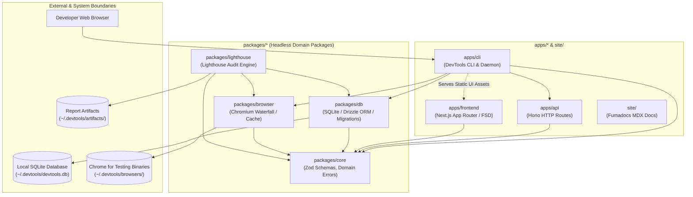

# DevTools System Architecture

System topology, component interactions, runtime lifecycles, and architectural boundaries across the DevTools monorepo.

## System architecture overview

DevTools is a developer tooling monorepo providing utilities across command-line, background daemon, HTTP API, and web dashboard interfaces. The system is designed around a set of core architectural principles:

1. **Three-tier monorepo composition**: Code is partitioned into deployable applications (`apps/*`), shared headless domain packages (`packages/*`), and a documentation platform (`site/`).
2. **Strict unidirectional dependencies**: Headless packages (`packages/*`) never import from applications (`apps/*`) or documentation (`site/`). `@devtools/core` is a zero-dependency foundation; `@devtools/db` and `@devtools/browser` consume `@devtools/core`, while `@devtools/lighthouse` consumes `@devtools/core`, `@devtools/db`, and `@devtools/browser`. Consuming applications depend on packages via Bun workspace protocols (`"workspace:*"`). Sibling applications never cross-import source files directly.
3. **Buildless development with direct source exports**: Internal packages declare direct source exports (`"exports": { ".": "./src/index.ts" }`). Consuming workspaces resolve TypeScript source files directly via `moduleResolution: "bundler"`, eliminating build steps during development.
4. **Unified loopback daemon host**: The local daemon (`devtools web`) consolidates backend API services (`apps/api` mounted on `/api/*`) and pre-rendered Next.js static assets (`apps/frontend/dist`) into a single Bun process listening on one port.
5. **Crash-resilient embedded persistence**: Local state is stored in an embedded SQLite database (`bun:sqlite`) using Drizzle ORM with Write-Ahead Logging (`WAL` mode) and startup migration execution per [ADR 0001](docs/adr/0001-embedded-database-foundation.md).
6. **Centralized configuration seams**: Domain packages isolate environment variable resolution into `config.ts` modules accepting injectable `options.env` seams for hermetic test execution per [ADR 0002](docs/adr/0002-package-configuration-and-environment-seams.md).
7. **3-tier Chromium resolution waterfall**: Automated browser resolution evaluates explicit overrides, local managed cache and system installations, before offering actionable terminal remediation.
8. **Feature-Sliced Design frontend**: The web dashboard is structured around FSD v2.1 layers (`app` -> `pages` -> `features` -> `entities` -> `shared`) with thin Next.js App Router boundary adapters.

## Component interaction model

## Architecture directory

Detailed architecture guides live under `docs/architecture/`:

### Monorepo and tool orchestration

- [Monorepo and CLI integration](docs/architecture/monorepo-and-cli.md): Workspace composition, tier ordering, direct source exports, how the codebase combines together, and standalone binary compilation.
- [CLI and loopback daemon architecture](docs/architecture/cli-and-daemon.md): `apps/cli` architecture, Commander command tree, lazy action execution, unified loopback daemon lifecycle, and signal handling.

### Application architectures

- [HTTP API architecture](docs/architecture/api.md): `apps/api` architecture, Hono route factory, in-process mounting, loopback CORS protection, and socketless testing.
- [Frontend application architecture](docs/architecture/frontend.md): `apps/frontend` architecture, Feature-Sliced Design v2.1 layers, App Router adapters, hydration safety, and static asset delivery.
- [Documentation site architecture](docs/architecture/site.md): `site/` platform architecture, Fumadocs MDX content pipeline, search index route, and LLM text endpoints.

### Package architectures

- [Persistence and database architecture](docs/architecture/persistence.md): `packages/db` architecture, embedded SQLite engine, WAL mode, Drizzle ORM schema, and startup migration execution.
- [Browser automation architecture](docs/architecture/browser.md): `packages/browser` architecture, 3-tier Chromium resolution waterfall algorithm, managed Chrome for Testing cache, and binary verification.
- [Performance auditing architecture](docs/architecture/lighthouse.md): `packages/lighthouse` architecture, isolated worker process execution, representative run selection, normalizer, and 3-tier persistence.

## Core runtime lifecycles

### Unified loopback daemon lifecycle (`devtools web`)

Running `devtools web` orchestrates SQLite migrations, mounts the in-process Hono API on `/api/*`, and serves pre-rendered Next.js frontend static assets through a single Bun HTTP daemon process on localhost.

For the full architectural sequence diagram, startup protocol, and port conflict handling, consult [CLI and Daemon Architecture](docs/architecture/cli-and-daemon.md).

### Chromium waterfall resolution algorithm (`devtools browser`)

Browser operations in `@devtools/browser` resolve Chromium binaries through a 3-tier deterministic waterfall: explicit user flags/environment overrides, managed cache probes in `~/.devtools/browsers/`, and system fallback probes.

For the detailed resolution flowchart, binary validation checks, and download protocols, consult [Browser Automation Architecture](docs/architecture/browser.md).

### Isolated Lighthouse audit lifecycle (`packages/lighthouse`)

Programmatic audits launch an isolated worker subprocess with an ephemeral Chrome port, select representative runs across multi-run batches via Euclidean distance minimization, and persist data across hot SQLite columns, warm JSON summaries, and cold disk artifacts.

For the sequence diagram, worker lifecycle guarantees, and 3-tier storage contracts, consult [Performance Auditing Architecture](docs/architecture/lighthouse.md).
