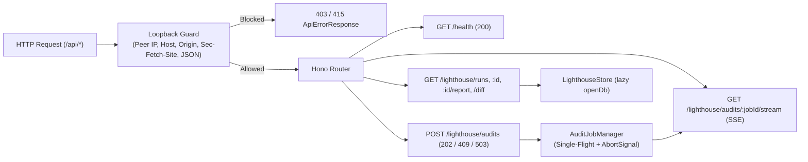

# HTTP API architecture

Route topology, loopback security boundaries, SSE streaming, and HTTP status and error contracts for `apps/api`.

## Module responsibilities

| Path                    | Responsibility                                                                                  | Entrypoint                             |
| :---------------------- | :---------------------------------------------------------------------------------------------- | :------------------------------------- |
| `apps/api/src/app/`     | Hono app factory (`create-app.ts`), standalone server lifecycle (`server.ts`, `server-cli.ts`). | `apps/api/src/app/index.ts`            |
| `apps/api/src/modules/` | Vertical route slices: `health/` probe and `lighthouse/` (`AuditJobManager`, SSE, reports).     | `apps/api/src/modules/*/index.ts`      |
| `apps/api/src/shared/`  | Canonical error envelope helpers (`http/`) and all-verb loopback guard (`security/`).           | `apps/api/src/shared/{http,security}/` |
| `apps/api/src/index.ts` | Curated public exports (`createApp`, `startServer`, `AppType`).                                 | `apps/api/src/index.ts`                |

`createApp(options?: CreateAppOptions)` in `apps/api/src/app/create-app.ts` returns a Hono app extended with `.shutdown()` rather than an ambient singleton. This decouples `apps/api` from `@devtools/db`, lets the Daemon mount `/api/*` in-process, and allows socketless testing via `app.request()` with injected `:memory:` `openLighthouseStore` instances and fake audit runners.

Both `startServer` (`apps/api/src/app/server.ts`) and `startDaemon` (`apps/cli/src/commands/web/daemon.ts`) coordinate 3-phase shutdown via `createShutdownCoordinator()` (`ingress` -> `work` -> `persistence`).

## Request and SSE lifecycle

## Mounted routes and SSE transport

| Method and path                            | Response                                                                       | Purpose                                                                      |
| :----------------------------------------- | :----------------------------------------------------------------------------- | :--------------------------------------------------------------------------- |
| `GET /api/health`                          | `200 OK` (`HealthResponseSchema`)                                              | Process liveness, uptime, and `APP_VERSION`.                                 |
| `POST /api/lighthouse/audits`              | `202 Accepted` (`AuditJobSchema`) / `409 Conflict` / `503 Service Unavailable` | Start a single-flight Audit Job unless shutting down.                        |
| `GET /api/lighthouse/audits/active`        | `200 OK` (`ActiveAuditJobResponseSchema`)                                      | Discover the active Audit Job for dashboard reload recovery.                 |
| `GET /api/lighthouse/audits/:jobId/stream` | `200 OK` (`text/event-stream`)                                                 | Replay latest snapshot and stream `progress`, `complete`, or `error` frames. |
| `GET /api/lighthouse/runs`                 | `200 OK` (`ListLighthouseRunsResponseSchema`)                                  | Paginated, filtered historical Audit Run list.                               |
| `GET /api/lighthouse/runs/:id`             | `200 OK` (`LighthouseRunDetailSchema`) / `409 Conflict`                        | Resolve full run detail by UUID or unique 6+ character prefix.               |
| `GET /api/lighthouse/runs/:id/report`      | `200 OK` (`text/html`)                                                         | Serve symlink-confined `report.html` inside an opaque-origin CSP sandbox.    |
| `GET /api/lighthouse/diff`                 | `200 OK` (`LighthouseDiffResponseSchema`)                                      | Compute score, Core Web Vitals, and Insight Audit deltas.                    |

## Loopback security boundary

> [!CAUTION]
> Never bind the API or Daemon to `0.0.0.0` by default. Loopback middleware in `apps/api/src/shared/security/middleware.ts` enforces peer IP, `Host`, `Origin`, and `Sec-Fetch-Site` checks across **all** `/api/*` verbs (including `GET`, SSE streams, and `report.html`).

1. **Interface binding.** Listens on `127.0.0.1`, `localhost`, or `[::1]` unless explicitly overridden.
2. **Socket peer verification.** Checks `server.requestIP(req)` for IPv4, IPv6, IPv4-mapped `[::ffff:127.0.0.1]`, or container-local host NAT when running under `Bun.serve`.
3. **DNS rebinding protection (`Host`).** Rejects any non-loopback `Host` header with `403 Forbidden`.
4. **CORS, `Origin`, and `Sec-Fetch-Site`.** Allows only loopback origins (`http://localhost:*`, `http://127.0.0.1:*`, `http://[::1]:*`, `http://[::ffff:127.0.0.1]:*`), rejects opaque `"null"` origins (including sandboxed report iframes), and denies `Sec-Fetch-Site: cross-site` across all HTTP methods.
5. **Mutating content-type guard.** Requires `Content-Type: application/json` on `POST`, `PUT`, `DELETE`, and `PATCH` payloads (`415 Unsupported Media Type` otherwise).

## HTTP status and error contracts

Cross-cutting schemas (`HealthResponseSchema`, `ApiErrorResponseSchema`, `API_ERROR_CODES`) live in `packages/core/src/errors.ts`; domain DTO and SSE schemas live in `@devtools/lighthouse/schemas` per [ADR 0003](../adr/0003-lighthouse-audit-isolation-and-tiered-storage.md) and [ADR 0004](../adr/0004-lighthouse-daemon-api-isolation-and-sse.md).

| Status | `API_ERROR_CODES`        | When returned                                                                    |
| :----- | :----------------------- | :------------------------------------------------------------------------------- |
| `200`  | _(none)_                 | Successful read, query, diff, or SSE stream.                                     |
| `201`  | _(none)_                 | Synchronous resource creation.                                                   |
| `202`  | _(none)_                 | Asynchronous Audit Job accepted (`POST /api/lighthouse/audits`).                 |
| `400`  | `BAD_REQUEST`            | Malformed JSON or syntax error.                                                  |
| `403`  | `FORBIDDEN`              | Blocked by loopback peer, `Host`, `Origin`, or `Sec-Fetch-Site` guard.           |
| `404`  | `NOT_FOUND`              | Unknown route or missing Audit Run / Audit Job.                                  |
| `409`  | `CONFLICT`               | Single-flight Audit Job already running or ambiguous short-ID prefix.            |
| `415`  | `UNSUPPORTED_MEDIA_TYPE` | Missing `application/json` `Content-Type` on a mutating request.                 |
| `422`  | `VALIDATION_ERROR`       | Request body or query parameter failed Zod validation.                           |
| `500`  | `INTERNAL_ERROR`         | Unhandled server exception.                                                      |
| `503`  | `SERVICE_UNAVAILABLE`    | Server shutting down (rejects new Audit Jobs) or backing dependency unavailable. |

For Hono route authoring rules and error envelope examples, see [HTTP API standards](../coding-standards/api.md).
