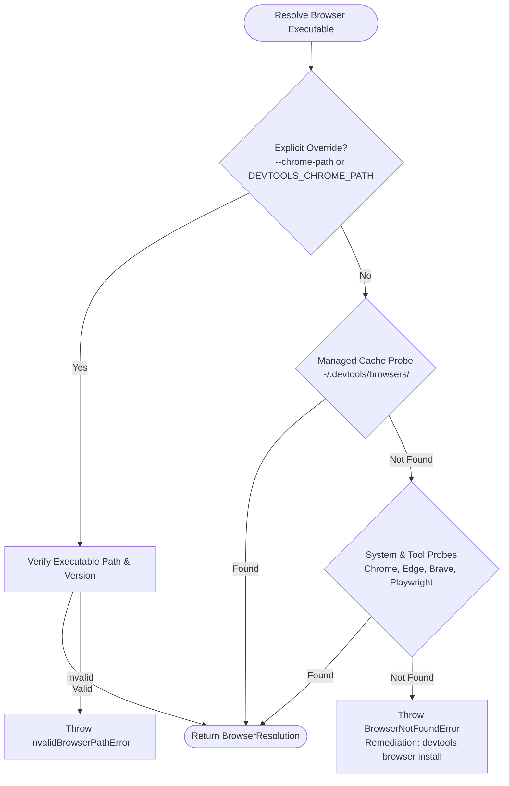

# Browser Automation Architecture

Architecture, Chromium resolution waterfall algorithm, binary verification, and managed cache management for `packages/browser`.

## Package structure

`packages/browser` manages Chromium browser detection, resolution, and local installation:

```text
packages/browser/
├── src/
│   ├── browser/
│   │   ├── detector.ts        # Executable verification & path detection
│   │   ├── installer.ts       # Chrome for Testing downloader & unpacker
│   │   ├── types.ts           # Browser resolution & probe contracts
│   │   ├── errors.ts          # Actionable domain error classes
│   │   └── waterfall.ts       # 3-tier Chromium resolution waterfall
│   ├── config.ts              # Cache directory resolution & env seams
│   └── index.ts               # Public library entrypoint
└── tests/                     # Unit test suites with dependency injection
```

## The 3-tier Chromium resolution waterfall

When DevTools requires a Chromium browser executable (for headless scraping, automation, or testing), it resolves the binary path using a 3-tier waterfall algorithm:



### Waterfall evaluation tiers

1. **Tier 1: Explicit override**:
   - Checks CLI flag `--chrome-path` or environment variable `DEVTOOLS_CHROME_PATH` (followed by `CHROME_PATH`).
   - If present, verifies executable permissions and version output. Throws `InvalidBrowserPathError` if invalid.
2. **Tier 2: Managed cache & system discovery**:
   - Probes the local managed cache directory (`~/.devtools/browsers/` or resolved via `DEVTOOLS_BROWSERS_DIR`).
   - Probes known operating system paths for existing Google Chrome or Chromium installations.
   - Probes alternative Chromium browsers (Microsoft Edge, Brave).
   - Probes test tool cache directories (Playwright, Puppeteer).
3. **Tier 3: Terminal remediation stop**:
   - If no compatible binary is discovered, throws `BrowserNotFoundError` detailing actionable remediation instructing the user to run `devtools browser install`.

## Binary verification and cache management

1. **Executable verification**: `verifyBrowserExecutable` ensures candidate binaries have execute permissions (`X_OK`), runs a smoke test invocation (`--version` or PowerShell ProductVersion on Windows) with a strict execution timeout, and extracts version metadata.
2. **Managed installation**: `installBrowser` resolves the latest stable build ID for `chrome-headless-shell`, invokes `@puppeteer/browsers` to download and unpack into `~/.devtools/browsers/`, and returns the installed executable path.
3. **Hermetic testing seam**: `waterfall.ts` accepts an optional `deps: WaterfallDependencies` seam to inject mock file probes and version testers, enabling deterministic testing without requiring physical browser downloads during CI runs.
