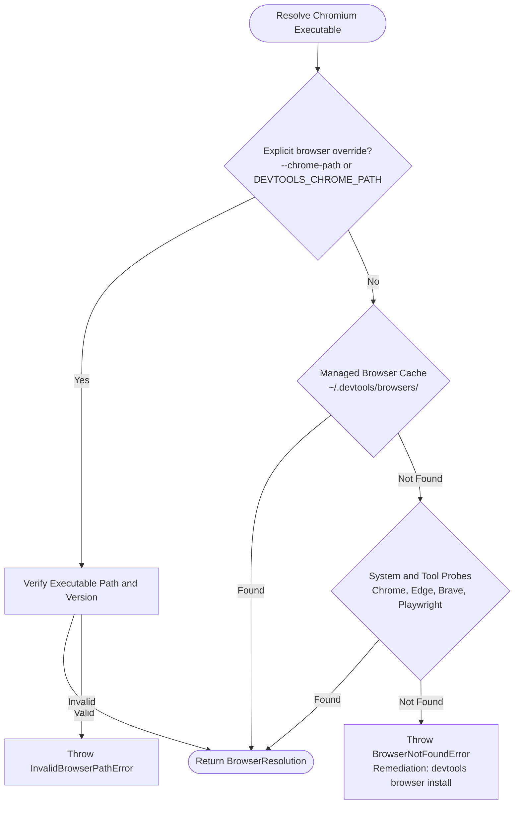

# Browser automation architecture

Chromium Browser Resolution Waterfall, executable verification, Managed Browser Cache, and headless session ownership for `packages/browser`.

## Module responsibilities

| Path                                | Responsibility                                                                        | Entrypoint                      |
| :---------------------------------- | :------------------------------------------------------------------------------------ | :------------------------------ |
| `packages/browser/src/config.ts`    | Managed Browser Cache path, Chromium sandbox policy, and configuration seams.         | `packages/browser/src/index.ts` |
| `packages/browser/src/waterfall.ts` | 3-tier Browser Resolution Waterfall with injectable `WaterfallDependencies`.          | `packages/browser/src/index.ts` |
| `packages/browser/src/detector.ts`  | Executable `X_OK` check, `--version` probe, and OS/tool path discovery.               | `packages/browser/src/index.ts` |
| `packages/browser/src/installer.ts` | Chrome for Testing (`chrome-headless-shell`) download and unpack into cache.          | `packages/browser/src/index.ts` |
| `packages/browser/src/launcher.ts`  | Headless Chrome session launcher (`launchBrowserSession`) and `AbortSignal` teardown. | `packages/browser/src/index.ts` |
| `packages/browser/src/errors.ts`    | Actionable errors (`BrowserNotFoundError`, `InvalidBrowserPathError`).                | `packages/browser/src/index.ts` |

## Browser Resolution Waterfall

| Tier | Sources evaluated                                                                                                                         | Failure behavior                                                      |
| :--: | :---------------------------------------------------------------------------------------------------------------------------------------- | :-------------------------------------------------------------------- |
|  1   | Explicit browser override (`--chrome-path`, `DEVTOOLS_CHROME_PATH`, then `CHROME_PATH`).                                                  | Throws `InvalidBrowserPathError` immediately if invalid.              |
|  2   | Managed Browser Cache (`~/.devtools/browsers/` or `DEVTOOLS_BROWSERS_DIR`), OS Chrome/Chromium, Edge, Brave, Playwright/Puppeteer caches. | Continues to next probe until a valid binary is verified.             |
|  3   | Terminal remediation stop.                                                                                                                | Throws `BrowserNotFoundError` pointing to `devtools browser install`. |

## Binary verification and cache management

- **Executable verification.** `verifyBrowserExecutable` checks execute permission (`X_OK`), runs a bounded `--version` check (or PowerShell `ProductVersion` on Windows), and parses version metadata.
- **Managed installation.** `installBrowser` resolves the latest stable `chrome-headless-shell` build via `@puppeteer/browsers`, unpacks into the Managed Browser Cache, and returns the executable path.
- **Hermetic testing seam.** `waterfall.ts` accepts `deps?: WaterfallDependencies` so unit and integration tests mock filesystem and version probes without downloading Chromium binaries.
