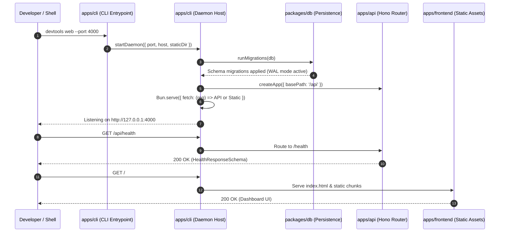

# CLI and Loopback Daemon Architecture

Detailed architecture, command routing, programmatic seams, and daemon lifecycles for `apps/cli`.

## Command-line interface architecture

`apps/cli` provides developer tooling commands via Commander.js:

```text
apps/cli/
├── bin/
│   └── devtools.js            # Executable shebang wrapper (4 lines)
├── src/
│   ├── cli.ts                 # Commander command tree & signal handling
│   ├── daemon.ts              # Unified loopback daemon implementation
│   ├── browser.ts             # Browser status & install command handlers
│   ├── port.ts                # Ephemeral & assigned port resolution
│   └── index.ts               # Programmatic re-exports for testing & embedding
└── tests/                     # Change-scoped unit & integration suites
```

### Command tree and routing

- `devtools`: Root program declaring global `--help`, `--version`, and debug flags.
- `devtools web`: Boots the unified loopback daemon, starts the local web dashboard, and mounts the API.
- `devtools browser status`: Queries Chromium resolution status across cache and system probes.
- `devtools browser install`: Downloads and caches Chrome for Testing binaries into the managed cache directory.

### Programmatic library seams

To decouple command logic from process execution, `src/index.ts` exports library functions:

- `createProgram()`: Assembles the Commander command tree without calling `parse()`.
- `runCli(argv)`: Parses command arguments and executes actions.
- `startDaemon(options)`: Boots the HTTP server and returns an instance handle with `.stop()` and `.port`.
- `runBrowserStatusCommand(options, deps)`: Executes browser resolution with injectable dependency seams.

This programmatic seam allows integration test suites to execute commands in-process without spawning OS child processes.

## Unified loopback daemon lifecycle

The loopback daemon unifies the backend API and frontend static dashboard into a single process listening on one port:



### Request routing and multiplexing

`startDaemon` creates a `Bun.serve()` server that inspects incoming HTTP request URLs:

1. **API Requests (`/api/*`)**: Handled in-process by the Hono application instance created via `createApp({ basePath: "/api" })` from `@devtools/api`.
2. **Static Frontend Assets (`/*`)**: Handled by `serveStaticAsset`, which resolves pre-rendered Next.js static files from `apps/frontend/dist` or candidate distribution directories.
3. **Security path traversal guard**: Requests containing path traversal sequences (`../`) are intercepted and rejected with HTTP 403 Forbidden.

### Port resolution and ephemeral binding

The daemon accepts `--port <number>`:

- Default port: `4000` (or resolved via `PORT`).
- Ephemeral port: When `--port 0` is supplied, the operating system assigns a free socket dynamically (`daemon.port`). Integration tests use this mechanism to prevent port collision in concurrent CI runners.

### Graceful shutdown and signal termination

`apps/cli/src/cli.ts` binds listeners for `SIGINT` and `SIGTERM`:

1. Intercepts termination signal.
2. Calls `daemon.stop()`, closing active sockets and draining connections.
3. Closes open SQLite database handles cleanly.
4. Exits with exit code 0.
