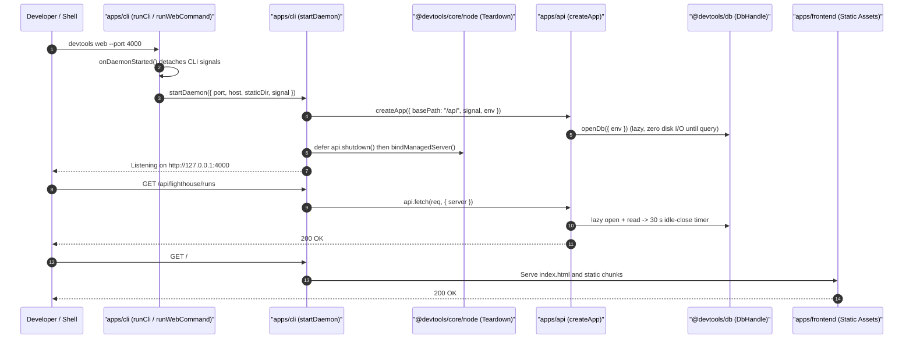

# CLI and Daemon architecture

Command routing, Programmatic CLI Seams, Daemon hosting, scoped LIFO teardown, and standalone binary bundling for `apps/cli`.

## Module responsibilities

| Path                       | Responsibility                                                                             | Entrypoint                         |
| :------------------------- | :----------------------------------------------------------------------------------------- | :--------------------------------- |
| `apps/cli/bin/devtools.js` | 4-line executable shebang delegating to `executeCliMain(import.meta.main)`.                | `apps/cli/bin/devtools.js`         |
| `apps/cli/src/app/`        | Commander tree + `createLazyLighthouseStore()` (`program.ts`) and host runner (`main.ts`). | `apps/cli/src/app/index.ts`        |
| `apps/cli/src/commands/`   | Isolated vertical slices for `browser`, `lighthouse`, and `web` (Daemon + port).           | `apps/cli/src/commands/*/index.ts` |
| `apps/cli/src/shared/`     | `NO_COLOR` / `FORCE_COLOR` / TTY color guards (`colors.ts`) and embedded asset types.      | `apps/cli/src/shared/terminal/`    |
| `apps/cli/src/index.ts`    | Curated Programmatic CLI Seam (`createProgram`, `runCli`, `startDaemon`).                  | `apps/cli/src/index.ts`            |

## Command tree

Commander registers command metadata synchronously so `--help` completes without importing heavy packages, while `createLazyLighthouseStore()` dynamically imports `@devtools/db` and `@devtools/lighthouse` only when a `lighthouse` subcommand runs (so `--help`, `--version`, and `browser` commands load zero SQLite/Drizzle modules).

| Command                                | Purpose                                                                                                     |
| :------------------------------------- | :---------------------------------------------------------------------------------------------------------- |
| `devtools`                             | Root program providing `--help` (`-h`) and `--version` (`-V`).                                              |
| `devtools web`                         | Starts the local Daemon serving `/api/*` and static frontend assets on one loopback port.                   |
| `devtools browser status`              | Queries Chromium resolution status across Managed Browser Cache and system probes (supports cancel signal). |
| `devtools browser install`             | Downloads and caches Chrome for Testing binaries with cooperative `AbortSignal` cancellation.               |
| `devtools lighthouse [url]`            | Runs isolated Lighthouse Audit Runs with `--agent`, `--json`, and `--fail-under` Performance Budgets.       |
| `devtools lighthouse list`             | Lists persisted Lighthouse Audit Runs from SQLite (validates options before opening the database).          |
| `devtools lighthouse diff <id1> <id2>` | Computes score, Core Web Vitals, and Insight Audit deltas via `@devtools/lighthouse`.                       |
| `devtools lighthouse open [id]`        | Opens a persisted `report.html` Report Artifact (or prints its `file://` URI in headless environments).     |

## Programmatic CLI Seams

`apps/cli/src/index.ts` exports in-process entrypoints decoupled from the executable wrapper:

- **`createProgram()`.** Builds the Commander command tree without calling `parse()`, wiring `createLazyLighthouseStore()` and forwarding the composition-root `signal` across `web`, `browser`, and `lighthouse` subcommands.
- **`runCli(argv)`.** Creates a scoped LIFO `Teardown`, attaches `attachHostSignals`, parses arguments, hands signal ownership to `onDaemonStarted` for `devtools web`, and closes any opened `DbHandle` in `finally` after `closeStore()` settles.
- **`startDaemon(options)`.** Mounts `createApp` (`/api/*`), defers `api.shutdown()` on a scoped `Teardown`, binds `Bun.serve()` via `bindManagedServer` from `@devtools/api`, and returns `.stop()`, `.port`, `.hostname`, and `.staticDir`.

Command slices expose injectable handlers behind their barrels (`runBrowserStatusCommand`, `runBrowserInstallCommand`, `registerLighthouseCommands`, `runLighthouse*Command`, `createLighthouseCliContext`, `runWebCommand`) so tests run commands in-process without spawning child processes. In `devtools web`, `handlePortPromptError` (`apps/cli/src/commands/web/command.ts`) catches `ExitPromptError` or an aborted `signal` during interactive port conflict prompts so `Ctrl+C` exits cleanly with code `130`.

## Daemon lifecycle

### Request multiplexing and port resolution

- **API routes (`/api/*`).** Handled in-process by `createApp()` from `@devtools/api`, forwarding `{ server }` bindings for socket peer IP checks and SSE timeout disabling (`server.timeout(req, 0)`).
- **Static assets (`/*`).** Resolved by `serveStaticAsset` from `apps/frontend/dist` (or `--static-dir`). Requests containing path traversal sequences (`../`) fail with `403 Forbidden`.
- **Port binding.** Defaults to `4000` (or `PORT`). Passing `--port 0` binds an OS-assigned ephemeral port (`daemon.port`) for concurrent test suites.

### Scoped LIFO teardown

`apps/cli/src/app/main.ts`, `apps/cli/src/commands/web/command.ts`, and `apps/cli/src/commands/web/daemon.ts` pair `attachHostSignals` with per-instance `createTeardown()` scopes from `@devtools/core/node`:

1. **Host Process Boundary.** Intercepts `SIGINT` and `SIGTERM` and triggers `teardown.run()` (a second signal force-exits with `130` or `143`).
2. **Ingress stop.** Runs the last-deferred step `server.stop(true)` (`bindManagedServer`) immediately while `POST /api/lighthouse/audits` returns `503 SERVICE_UNAVAILABLE`.
3. **Active work abort.** Aborts `teardown.signal` and awaits `api.shutdown()` (`AuditJobManager.shutdown()`) to cancel running Chromium audits and close SSE streams.
4. **Database close.** Closes any composition-root `DbHandle` (`ownedDb.close()`, or `lazyStore.closeStore()` in short-lived CLI commands after `ctx.closeStore()` runs outside `try`), then exits (`0` for long-running servers, `130` or `143` for short-lived CLI commands).

## Standalone binary compilation

Running `bun run build:bin` compiles `apps/cli/bin/devtools.js` with `bun build --compile --minify --bytecode` into a self-contained single-file executable (`dist/devtools`) embedding the Bun runtime, bytecode, bundled baseline SQL schema, and Lighthouse assets with no external Bun dependency. For release targets and Checksum Manifests, see [Releases and distribution](../contributing/releases.md).
