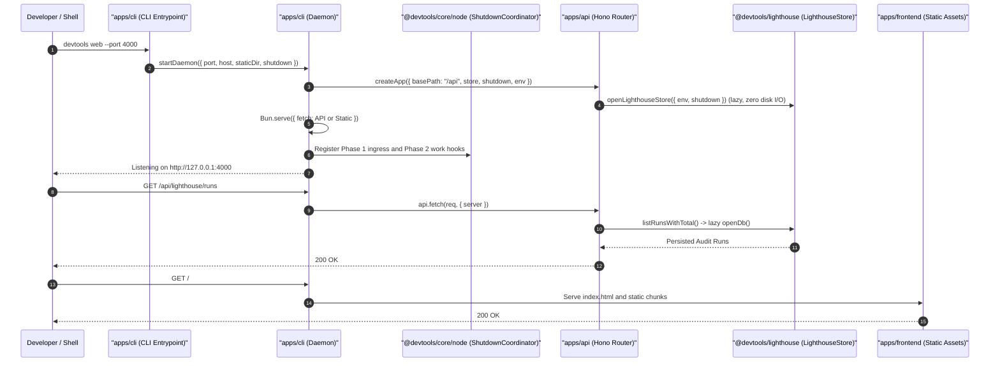

# CLI and Daemon architecture

Command routing, Programmatic CLI Seams, Daemon hosting, 3-phase shutdown, and standalone binary bundling for `apps/cli`.

## Module responsibilities

| Path                       | Responsibility                                                                   | Entrypoint                         |
| :------------------------- | :------------------------------------------------------------------------------- | :--------------------------------- |
| `apps/cli/bin/devtools.js` | 4-line executable shebang delegating to `executeCliMain(import.meta.main)`.      | `apps/cli/bin/devtools.js`         |
| `apps/cli/src/app/`        | Commander tree assembly (`program.ts`) and host runner (`main.ts`).              | `apps/cli/src/app/index.ts`        |
| `apps/cli/src/commands/`   | Isolated vertical slices for `browser`, `lighthouse`, and `web` (Daemon + port). | `apps/cli/src/commands/*/index.ts` |
| `apps/cli/src/shared/`     | `NO_COLOR` / `FORCE_COLOR` / TTY color guards and embedded asset declarations.   | `apps/cli/src/shared/terminal/`    |
| `apps/cli/src/index.ts`    | Curated Programmatic CLI Seam (`createProgram`, `runCli`, `startDaemon`).        | `apps/cli/src/index.ts`            |

## Command tree

Commander registers command metadata synchronously so `--help` completes in under 20 ms, while action handlers dynamically import heavy modules on demand.

| Command                                | Purpose                                                                                                 |
| :------------------------------------- | :------------------------------------------------------------------------------------------------------ |
| `devtools`                             | Root program providing `--help` (`-h`) and `--version` (`-V`).                                          |
| `devtools web`                         | Starts the local Daemon serving `/api/*` and static frontend assets on one loopback port.               |
| `devtools browser status`              | Queries Chromium resolution status across Managed Browser Cache and system probes.                      |
| `devtools browser install`             | Downloads and caches Chrome for Testing binaries into the Managed Browser Cache.                        |
| `devtools lighthouse [url]`            | Runs isolated Lighthouse Audit Runs with `--agent`, `--json`, and `--fail-under` Performance Budgets.   |
| `devtools lighthouse list`             | Lists persisted Lighthouse Audit Runs from SQLite.                                                      |
| `devtools lighthouse diff <id1> <id2>` | Computes score, Core Web Vitals, and Insight Audit deltas via `@devtools/lighthouse`.                   |
| `devtools lighthouse open [id]`        | Opens a persisted `report.html` Report Artifact (or prints its `file://` URI in headless environments). |

## Programmatic CLI Seams

`apps/cli/src/index.ts` exports in-process entrypoints decoupled from the executable wrapper:

- **`createProgram()`.** Builds the Commander command tree without calling `parse()`.
- **`runCli(argv)`.** Parses arguments and invokes matching actions.
- **`startDaemon(options)`.** Lazily wires `openLighthouseStore`, mounts `/api/*`, registers Phase 1 (`ingress`) and Phase 2 (`work`) hooks on `ShutdownCoordinator`, starts `Bun.serve()`, and returns `.stop()`, `.port`, `.hostname`, and `.staticDir`.

Command slices expose injectable handlers behind their barrels (`runBrowserStatusCommand`, `runBrowserInstallCommand`, `registerLighthouseCommands`, `runLighthouse*Command`, `createLighthouseCliContext`, `runWebCommand`) so tests run commands in-process without spawning child processes.

## Daemon lifecycle

### Request multiplexing and port resolution

- **API routes (`/api/*`).** Handled in-process by `createApp()` from `@devtools/api`, forwarding `{ server }` bindings for socket peer IP checks and SSE timeout disabling (`server.timeout(req, 0)`).
- **Static assets (`/*`).** Resolved by `serveStaticAsset` from `apps/frontend/dist` (or `--static-dir`). Requests containing path traversal sequences (`../`) fail with `403 Forbidden`.
- **Port binding.** Defaults to `4000` (or `PORT`). Passing `--port 0` binds an OS-assigned ephemeral port (`daemon.port`) for concurrent test suites.

### 3-phase Shutdown Coordinator

`apps/cli/src/app/main.ts` and `apps/cli/src/commands/web/command.ts` delegate `SIGINT` and `SIGTERM` handling to `attachHostSignals` and `createShutdownCoordinator()` from `@devtools/core/node`:

1. **Host Process Boundary.** Intercepts `SIGINT` and `SIGTERM` (a second signal force-exits with `130` or `143`).
2. **Phase 1 (`ingress`).** Calls `server.stop(true)` to halt new HTTP connections while `POST /api/lighthouse/audits` returns `503 SERVICE_UNAVAILABLE`.
3. **Phase 2 (`work`).** Aborts the shared `AbortSignal`, awaits `api.shutdown()` to cancel active Audit Jobs and settle SSE streams, and closes owned stores.
4. **Phase 3 (`persistence`).** Runs self-registered `@devtools/db` hooks to flush WAL checkpoints and close SQLite handles, then exits with code `0`.

## Standalone binary compilation

Running `bun run build:bin` compiles `apps/cli/bin/devtools.js` with `bun build --compile --minify --bytecode` into a self-contained single-file executable (`dist/devtools`) embedding the Bun runtime, bytecode, bundled baseline SQL schema, and Lighthouse assets with no external Bun dependency. For release targets and Checksum Manifests, see [Releases and distribution](../contributing/releases.md).
