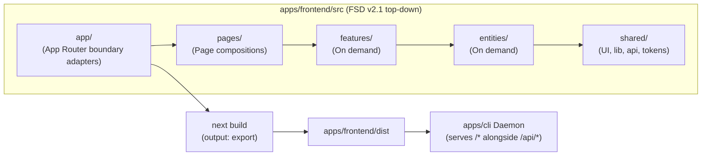

# Frontend application architecture

Feature-Sliced Design (FSD) v2.1 topology, Next.js App Router static export, and Daemon asset delivery for `apps/frontend`.

## Layer topology and delivery flow

| Layer       | Responsibility                                                                                                                                                                      | Public boundary             |
| :---------- | :---------------------------------------------------------------------------------------------------------------------------------------------------------------------------------- | :-------------------------- |
| `app/`      | Thin App Router boundary adapters (`page.next.tsx`, `layout.next.tsx`), runtime context providers (`app/providers/`), and app-wide layout chrome (`app/layouts/app-shell/`).        | Next.js `pageExtensions`    |
| `pages/`    | Full-page compositions, page-scoped state, and query orchestration (supports domain slice groups such as `pages/lighthouse/{history,compare,run}`).                                 | `pages/<slice>/index.ts`    |
| `features/` | Reusable user interactions carrying business value, extracted when shared across distinct pages or app layouts (supports groups like `features/lighthouse/*`).                      | `features/<slice>/index.ts` |
| `entities/` | Reusable domain API clients, TanStack Query factories (`lighthouseQueries`), formatting models, and domain views (such as `entities/lighthouse-run`).                               | `entities/<slice>/index.ts` |
| `shared/`   | Reusable pure presentational UI (`shadcn/` and `blocks/` with zero business logic or upper-layer imports), fetch client, semantic theme tokens, and reactive query-param hydration. | `shared/<segment>/index.ts` |

## Static export and Daemon delivery

`apps/frontend/next.config.ts` sets `output: "export"`, `distDir: "dist"`, and `pageExtensions: ["next.tsx", "next.ts"]`:

- `bun --filter @devtools/frontend build` compiles static HTML, CSS, and client JS bundles into `apps/frontend/dist`.
- `startDaemon` (`apps/cli/src/commands/web/daemon.ts`) serves these static files on `/*` while mounting `@devtools/api` on `/api/*`, avoiding a separate production Next.js server process.
- Runtime entity views route through flat static paths paired with query parameters (`?id=`, `?job=`, `?tab=`, `?runs=`, `?baseline=`) instead of dynamic `[id]` segments, per [ADR 0007](../adr/0007-static-export-query-param-routing.md).
- Frontend requests use relative `/api/*` paths (including SSE `EventSource` and `<iframe sandbox="allow-scripts allow-popups allow-downloads">` report views), and `apps/frontend` imports only browser-safe workspace packages (`@devtools/core` and `@devtools/lighthouse/schemas`), enforced by `.fallowrc.json`.

For FSD authoring rules, Storybook portable stories, React 19 standards, and tear-free client hydration hooks, see [Frontend standards](../coding-standards/frontend.md).
