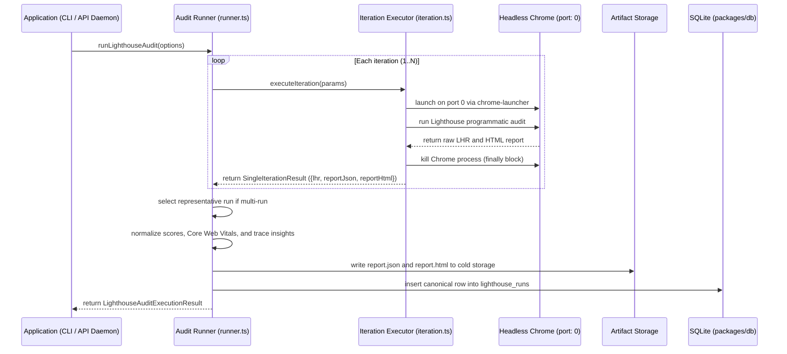

# Performance Auditing Architecture

Architecture, direct in-process execution with `AbortSignal` cancellation, representative run selection, and 3-tier audit persistence for `packages/lighthouse`.

## Package structure

`packages/lighthouse` provides programmatic Lighthouse audit orchestration, metric normalization, and tiered storage:

```text
packages/lighthouse/
├── src/
│   ├── abort.ts               # AbortSignal cancellation guard (throwIfAborted)
│   ├── config.ts              # Artifacts directory resolution, path confinement, & env seams
│   ├── diff.ts                # Pairwise score, CWV, and insight audit diffing
│   ├── errors.ts              # Actionable domain error classes (including AuditCancelledError)
│   ├── index.ts               # Public package entrypoint
│   ├── iteration.ts           # Headless Chrome iteration execution & AbortSignal cleanup
│   ├── median.ts              # Representative run selection via Euclidean distance
│   ├── normalizer.ts          # LHR extraction, TTFB fallback, & trace insights
│   ├── runner.ts              # Multi-run orchestrator, AbortSignal forwarding & batch normalization
│   ├── runs.ts                # Drizzle SQLite persistence, queries, & short-ID lookup
│   ├── schemas.ts             # Browser-safe Zod DTO & SSE contract schemas
│   └── types.ts               # Domain models, runner options, & summary types
└── tests/                     # Unit & headless Chromium integration test suites
```

## Direct in-process iteration execution

`packages/lighthouse` provides direct in-process iteration execution (`executeIteration`) while guaranteeing browser process isolation and deterministic cleanup:



### Execution lifecycle guarantees

1. **In-process domain purity**: `executeIteration` executes directly within the active JavaScript runtime without spawning child script processes via `Bun.spawn`. Standalone compiled binaries (`dist/devtools`) execute audits out-of-the-box without requiring an external `bun` interpreter or loose script files on disk. Concurrency isolation and background scheduling belong to application service layers (`apps/api`).
2. **Ephemeral port assignment**: Chrome launches with `port: 0` to let the operating system allocate an available port, avoiding port collisions during concurrent test or audit runs.
3. **Deterministic cleanup and cooperative cancellation**: `executeIteration` and `executeLighthouseBatch` accept `signal?: AbortSignal` to stop multi-run loops between iterations and immediately kill headless Chrome on abort, alongside a `finally` block and `SIGTERM`/`SIGINT` handlers guaranteeing `chrome.kill()` terminates the browser process upon normal completion, cancellation, or unhandled errors.

## Representative run selection algorithm

When an audit requests multiple iterations (`--runs <N>` where $N > 1$), `computeRepresentativeRun` identifies a single canonical iteration from the batch rather than synthesizing independent metric medians that contradict report artifacts.

1. **Batch median calculation**: Computes the median First Contentful Paint (`first-contentful-paint`) and median Time to Interactive (`interactive`, falling back to `total-blocking-time` when interactive is null) across all completed runs.
2. **Euclidean distance minimization**: Evaluates squared Euclidean distance from each run to the batch medians:
   $$D^2 = (FCP_i - \widetilde{FCP})^2 + (TTI_i - \widetilde{TTI})^2$$
3. **Deterministic tie-breaking**: If two runs share identical minimum distances, the earlier run in execution order is selected.
4. **Distribution preservation**: Preserves min, max, median, and per-run values inside `summary_json.medianMetadata`.

## 3-tier storage architecture

Audit results range from sub-millisecond status checks to multi-megabyte trace reports. Storage is partitioned into three tiers:

1. **Hot relational columns (`lighthouse_runs` in `@devtools/db`)**: Indexed SQLite columns store target URL, final URL, form factor, throttling profile, timestamps, duration, the 4 integer category scores (0–100), and the 6 Core Web Vitals (`lcp_ms`, `cls`, `tbt_ms`, `fcp_ms`, `si_ms`, `ttfb_ms`).
2. **Warm structured summary (`summary_json`)**: A compact (5–15 KB) JSON blob stored in SQLite containing LCP element and phase breakdowns, CLS culprits, prioritized insight audits, and failed audit messages.
3. **Cold disk artifacts (`report.json` and `report.html`)**: Raw Lighthouse Result JSON and standalone HTML reports written to `<artifactsDir>/<runId>/`.

## Configuration seams (ADR 0002)

`packages/lighthouse/src/config.ts` accepts an optional `options.env` seam and resolves the artifacts directory using a 4-tier waterfall:

1. **Explicit options**: `options.customDir` if provided.
2. **Environment override**: `DEVTOOLS_LIGHTHOUSE_ARTIFACTS_DIR` if set.
3. **Development fallback**: `<repo_root>/.devtools/artifacts/lighthouse` in development mode (`NODE_ENV !== "production"`).
4. **Production default**: `~/.devtools/artifacts/lighthouse` in production mode.
