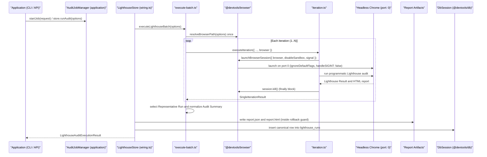

# Performance auditing architecture

Direct in-process Lighthouse execution with `AbortSignal` cancellation, Representative Run selection, and 3-tier audit persistence for `packages/lighthouse`.

## Module responsibilities

| Path                                   | Responsibility                                                                                               | Entrypoint                                                                      |
| :------------------------------------- | :----------------------------------------------------------------------------------------------------------- | :------------------------------------------------------------------------------ |
| `packages/lighthouse/src/contracts/`   | Actionable errors (`AuditCancelledError`, `WorkerExecutionError`), models, and browser-safe Zod DTOs.        | `packages/lighthouse/src/contracts/schemas.ts` (`@devtools/lighthouse/schemas`) |
| `packages/lighthouse/src/domain/`      | Pure `AbortSignal` guard, pairwise `diff`, Euclidean `median`, and LHR `normalizer`.                         | `packages/lighthouse/src/domain/index.ts`                                       |
| `packages/lighthouse/src/application/` | Pure multi-run batch orchestration (`execute-batch.ts`) and single-flight `AuditJobManager` over ports.      | `packages/lighthouse/src/application/index.ts`                                  |
| `packages/lighthouse/src/config/`      | Artifact directory resolution and symlink confinement (`artifacts-config.ts`).                               | `packages/lighthouse/src/config/index.ts`                                       |
| `packages/lighthouse/src/infra/`       | SQLite store (`persistence/`) and in-process Chrome iteration + virtual FS shim (`runtime/`).                | `packages/lighthouse/src/wiring.ts`                                             |
| `packages/lighthouse/src/index.ts`     | Public entrypoint (`createLighthouseStore`, `createAuditJobManager`, `executeLighthouseBatch`, serializers). | `packages/lighthouse/src/index.ts`                                              |

## Direct in-process iteration execution

### Execution lifecycle guarantees

1. **In-process purity and borrowed `DbSession` (ADR 0005 and ADR 0006).** `executeIteration` (`packages/lighthouse/src/infra/runtime/iteration.ts`) runs inside the active runtime with no `Bun.spawn` worker scripts per [ADR 0005](../adr/0005-in-process-lighthouse-execution.md), activating `ensureLighthouseVirtualFs()` lazily only during real executions so compiled binaries (`dist/devtools`) work out of the box. `createLighthouseStore({ db })` (`packages/lighthouse/src/wiring.ts`) operates over a caller-borrowed `DbSession` (never owning or closing the database handle), providing rollback-safe `persistBatch` (artifact directory creation and writes sit inside the `try/catch` alongside best-effort cleanup), read-only artifact path checks without `mkdirSync`, and `BEGIN DEFERRED` snapshot transactions for `listRunsWithTotal` and `diffRuns`.
2. **Domain-owned single-flight jobs and serializers.** `createAuditJobManager` (`packages/lighthouse/src/application/job-manager.ts`, backed by `packages/lighthouse/src/serializers.ts`) coordinates single-flight active web audit state, progress replay, 5-minute terminal job retention, and `AbortSignal` shutdown so `apps/api` remains a thin HTTP/SSE adapter.
3. **Batch-once browser resolution and ephemeral ports.** `executeLighthouseBatch` resolves Chromium once per batch and launches Chrome with `port: 0` and `ignoreDefaultFlags: true`.
4. **Cooperative cancellation.** `signal?: AbortSignal` flows through browser discovery, Chrome launch (`handleSIGINT: false`), iteration loops, and post-batch persistence, with `session.kill()` always running in `finally`.

## Representative Run selection

When an Audit Run batch executes multiple iterations (`--runs <N>`, $N > 1$), `computeRepresentativeRun` selects one actual run closest to the batch median rather than synthesizing contradictory per-metric medians:

1. Compute median First Contentful Paint (`first-contentful-paint`) and median Time to Interactive (`interactive`, falling back to `total-blocking-time` when null).
2. Minimize squared Euclidean distance per run:
   $$D^2 = (FCP_i - \widetilde{FCP})^2 + (TTI_i - \widetilde{TTI})^2$$
3. Break ties deterministically in favor of the earlier run, and retain distribution statistics inside `summary_json.medianMetadata`.

## 3-tier storage architecture

Per [ADR 0003](../adr/0003-lighthouse-audit-isolation-and-tiered-storage.md), `LighthouseStore` partitions persisted audit data across three tiers:

| Tier     | Storage location                            | Contents                                                                                                 |
| :------- | :------------------------------------------ | :------------------------------------------------------------------------------------------------------- |
| **Hot**  | Indexed `lighthouse_runs` SQLite columns    | URLs, form factor, throttling profile, timestamps, 4 category scores (`0` to `100`), 6 Core Web Vitals.  |
| **Warm** | `summary_json` SQLite column (~5 to 15 KB)  | Normalized Audit Summary: LCP/CLS attributions, prioritized Insight Audits, failed checks, distribution. |
| **Cold** | `<artifactsDir>/<runId>/report.{json,html}` | Full Lighthouse JSON and standalone HTML Report Artifacts; removed automatically if DB insert fails.     |

The `listLighthouseRuns` query omits `summary_json` to keep paginated responses light, `resolveLighthouseRun` uses a Unicode scalar indexed range scan (`id >= ? AND id < ? LIMIT 6`) for short-ID prefix matching, and serializers hoist `resolveCanonicalArtifactsDir(artifactsDir)` once per response before checking per-row report confinement. The `summary_json` column uses a tolerant JSON read boundary (`tolerantJsonText` in `packages/db/src/schema/lighthouse.ts` paired with `parseRunSummary` in `packages/lighthouse/src/infra/persistence/sqlite-runs.ts`). Unreadable or schema-invalid payloads load as `null` on `LighthouseRunRecord` so `computeRunDeltas` returns neutral insight diffs (`clsCulpritDelta: null`) instead of false improvements or regressions, while API and CLI display boundaries apply `EMPTY_LIGHTHOUSE_RUN_SUMMARY`.

## Artifact configuration seam

`packages/lighthouse/src/config/artifacts-config.ts` resolves `<artifactsDir>` using injectable `env`, `cwd`, and `isStandalone` configuration seams:

| Priority | Condition                                                  | Resolved directory                           |
| :------: | :--------------------------------------------------------- | :------------------------------------------- |
|    1     | `options.customDir` or `DEVTOOLS_LIGHTHOUSE_ARTIFACTS_DIR` | Explicit override path                       |
|    2     | `NODE_ENV === "test"` or `BUN_ENV === "test"`              | `<tmpdir>/devtools-tests/lighthouse`         |
|    3     | Local workspace development (`!isStandaloneRuntime()`)     | `<repo_root>/.devtools/artifacts/lighthouse` |
|    4     | Compiled standalone binary or production default           | `~/.devtools/artifacts/lighthouse`           |
