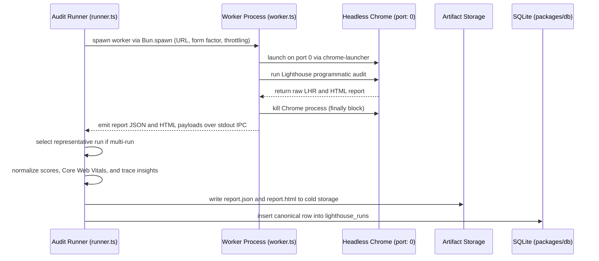

# Performance Auditing Architecture

Architecture, isolated worker process execution, representative run selection, and 3-tier audit persistence for `packages/lighthouse`.

## Package structure

`packages/lighthouse` provides programmatic Lighthouse audit orchestration, metric normalization, and tiered storage:

```text
packages/lighthouse/
├── src/
│   ├── config.ts              # Artifacts directory resolution & env seams
│   ├── errors.ts              # Actionable domain error classes
│   ├── index.ts               # Public package entrypoint
│   ├── median.ts              # Representative run selection via Euclidean distance
│   ├── normalizer.ts          # LHR extraction, TTFB fallback, & trace insights
│   ├── repository.ts          # Drizzle SQLite persistence & queries
│   ├── runner.ts              # Multi-run orchestrator & worker lifecycle
│   ├── types.ts               # Zod schemas, domain models, & summary types
│   └── worker.ts              # Isolated Bun.spawn worker with Chrome port: 0
└── tests/                     # Unit & headless Chromium integration test suites
```

## Subprocess worker isolation

Lighthouse v13 executes CPU-intensive trace analysis, frame-by-frame Speedline decoding, and synchronous report generation while mutating process-global state in `lighthouse-logger`. Running Lighthouse on the main process thread blocks the event loop and corrupts concurrent executions.

Per [ADR 0003](../adr/0003-lighthouse-audit-isolation-and-tiered-storage.md), `@devtools/lighthouse` delegates execution to an isolated worker subprocess:



### Worker lifecycle guarantees

1. **Subprocess boundary**: `executeIterationInSubprocess` launches `worker.ts` with `Bun.spawn`, passing the serialized audit payload through standard input (`stdin`) and receiving progress events and final report payloads over standard output (`stdout`) IPC.
2. **Ephemeral port assignment**: Chrome launches with `port: 0` to let the operating system allocate an available port, avoiding port collisions during concurrent test or audit runs.
3. **Deterministic cleanup**: A `finally` block in `worker.ts` along with `SIGTERM`/`SIGINT` signal handlers ensures `chrome.kill()` terminates the browser process upon normal completion, unhandled errors, or handled lifecycle signals.

## Representative run selection algorithm

When an audit requests multiple iterations (`--runs <N>` where $N > 1$), `computeRepresentativeRun` identifies a single canonical iteration from the batch rather than synthesizing independent metric medians that contradict report artifacts.

1. **Batch median calculation**: Computes the median First Contentful Paint (`first-contentful-paint`) and median Time to Interactive (`interactive`, falling back to `total-blocking-time` when interactive is null) across all completed runs.
2. **Euclidean distance minimization**: Evaluates squared Euclidean distance from each run to the batch medians:
   $$D^2 = (FCP_i - \widetilde{FCP})^2 + (TTI_i - \widetilde{TTI})^2$$
3. **Deterministic tie-breaking**: If two runs share identical minimum distances, the earlier run in execution order is selected.
4. **Distribution preservation**: Preserves min, max, median, and per-run values inside `summary_json.medianMetadata`.

## 3-tier storage architecture

Audit results range from sub-millisecond status checks to multi-megabyte trace reports. Storage is partitioned into three tiers:

1. **Hot relational columns (`lighthouse_runs` in `@devtools/db`)**: Indexed SQLite columns store target URL, final URL, form factor, throttling profile, timestamps, duration, the 4 integer category scores (0–100), and the 6 Core Web Vitals (`lcp_ms`, `cls`, `tbt_ms`, `fcp_ms`, `si_ms`, `ttfb_ms`).
2. **Warm structured summary (`summary_json`)**: A compact (5–15 KB) JSON blob stored in SQLite containing LCP element and phase breakdowns, CLS culprits, prioritized insight audits, and failed audit messages.
3. **Cold disk artifacts (`report.json` and `report.html`)**: Raw Lighthouse Result JSON and standalone HTML reports written to `<artifactsDir>/<runId>/`.

## Configuration seams (ADR 0002)

`packages/lighthouse/src/config.ts` accepts an optional `options.env` seam and resolves the artifacts directory using a 4-tier waterfall:

1. **Explicit options**: `options.customDir` if provided.
2. **Environment override**: `DEVTOOLS_LIGHTHOUSE_ARTIFACTS_DIR` if set.
3. **Development fallback**: `<repo_root>/.devtools/artifacts/lighthouse` in development mode (`NODE_ENV !== "production"`).
4. **Production default**: `~/.devtools/artifacts/lighthouse` in production mode.
