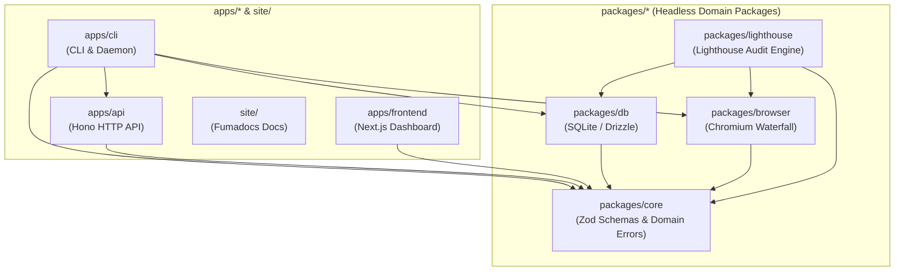

# Monorepo and CLI Integration Architecture

How the DevTools monorepo workspaces, headless packages, and CLI tool combine together into a unified developer tooling system.

## Monorepo topology and workspace composition

DevTools is organized as a Bun monorepo partitioning code into three functional tiers:

```text
devtools/
├── apps/                         # Deployable applications & runtime hosts
│   ├── cli/                      # Developer CLI & unified loopback daemon host
│   ├── api/                      # In-process Hono HTTP API server & route handlers
│   └── frontend/                 # Next.js web dashboard (FSD v2.1 architecture)
├── packages/                     # Shared headless domain packages
│   ├── core/                     # Shared Zod schemas, domain models, error constants
│   ├── db/                       # Embedded SQLite persistence, Drizzle ORM, migrations
│   ├── browser/                  # Chromium resolution waterfall & managed cache
│   └── lighthouse/               # Isolated Lighthouse audit engine & normalizer
└── site/                         # Fumadocs documentation platform & LLM endpoints
```

Consuming workspaces reference internal packages via Bun workspace protocols (`"workspace:*"`).

## Dependency topology and tier ordering

The monorepo enforces a strict unidirectional dependency graph:



### Architectural tier invariants

1. **Headless domain packages (`packages/*`)**:
   - Leaf foundation: `@devtools/core` has zero workspace dependencies and declares shared Zod schemas, error primitives, and configuration types.
   - Persistence and automation: `@devtools/db` and `@devtools/browser` consume `@devtools/core`.
   - Performance auditing: `@devtools/lighthouse` consumes `@devtools/core`, `@devtools/db`, and `@devtools/browser`.
   - Invariant: Packages must **never** import from applications (`apps/*`) or documentation (`site/`).
2. **Deployable applications (`apps/*`)**:
   - Applications consume headless packages via `"workspace:*"`.
   - Sibling applications (`apps/api`, `apps/frontend`) remain siloed; they never cross-import source files directly.
3. **Buildless development with direct source exports**:
   - Internal packages declare direct source exports in `package.json` (`"exports": { ".": "./src/index.ts" }`).
   - Combined with `moduleResolution: "bundler"`, applications resolve TypeScript source files directly without intermediate compilation lag.

## CLI integration and runtime orchestration

`apps/cli` serves as the primary system orchestrator, bridging terminal commands, background services, and web interfaces:

1. **Binary entrypoint to library seam**:
   - The executable `apps/cli/bin/devtools.js` contains a 4-line shebang delegating directly to `runCli()` in `src/cli.ts`.
   - All commands, program builders, and daemon lifecycles are exported programmatically from `src/index.ts`, enabling test suites to invoke CLI logic in-process.
2. **Synchronous metadata and lazy action execution**:
   - Commander.js registers command structures and options synchronously, ensuring `--help` cold starts in under 20ms.
   - Heavy execution logic (SQLite initialization, Chromium downloading, server startup) is dynamically imported only when a specific command action runs.
3. **Unified loopback daemon host**:
   - Rather than requiring multiple processes or ports, running `devtools web` starts a single Bun HTTP daemon process.
   - The daemon runs SQLite migrations, mounts the in-process Hono API application from `apps/api` on `/api/*`, and serves pre-rendered Next.js frontend static assets on all other paths.
4. **Standalone binary compilation**:
   - For distribution without requiring a local Bun installation, `bun build apps/cli/bin/devtools.js --compile --outfile dist/devtools` produces a self-contained single-file executable embedding the Bun engine, bytecode, and dependencies.

For deep details on daemon startup lifecycles, graceful shutdown, and CLI testing seams, consult [CLI and Daemon Architecture](docs/architecture/cli-and-daemon.md).
