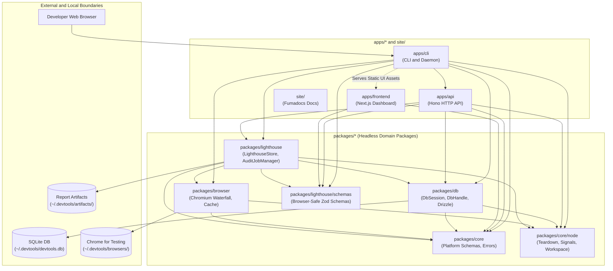

# Monorepo architecture

At-a-glance map of workspaces, folder ownership, dependency boundaries, and direct TypeScript source exports across the DevTools Bun monorepo.

## Workspace composition

DevTools partitions code into three tiers linked via Bun workspace references (`"workspace:*"`):

| Tier             | Directory             | Package                | Hosts                                                                                     |
| :--------------- | :-------------------- | :--------------------- | :---------------------------------------------------------------------------------------- |
| **Applications** | `apps/cli`            | `@devtools/cli`        | CLI commands, Programmatic CLI Seams, Daemon host, lazy DB wiring, and binary entrypoint. |
| **Applications** | `apps/api`            | `@devtools/api`        | In-process Hono HTTP API (`/api/*`), loopback security middleware, and `DbHandle` wiring. |
| **Applications** | `apps/frontend`       | `@devtools/frontend`   | Next.js App Router dashboard (FSD v2.1) exported as static assets for the Daemon.         |
| **Packages**     | `packages/core`       | `@devtools/core`       | Browser-safe platform schemas and errors (`.`) plus Node/Bun host utilities (`./node`).   |
| **Packages**     | `packages/db`         | `@devtools/db`         | Embedded SQLite (`bun:sqlite`) `DbSession`/`DbHandle` lifecycle and Drizzle schemas.      |
| **Packages**     | `packages/browser`    | `@devtools/browser`    | Chromium Browser Resolution Waterfall, Managed Browser Cache, and Chrome launcher.        |
| **Packages**     | `packages/lighthouse` | `@devtools/lighthouse` | In-process Lighthouse engine, `AuditJobManager`, `./schemas`, and 3-tier persistence.     |
| **Site**         | `site`                | `@devtools/site`       | Public Fumadocs documentation website and `/llms.txt` endpoints.                          |

Repository tooling lives outside workspace packages under `scripts/` (coverage, diff coverage, secret scanning, agent governance, migration checks), `.github/` (CI and release workflows), and `docs/` (engineering guides, ADRs, glossaries).

## Component interaction model

## Dependency boundaries

Architectural import zones are enforced mechanically in [`.fallowrc.json`](../../.fallowrc.json) via `bun run fallow:arch`:

1. **Unidirectional package hierarchy.** Headless packages (`packages/*`) never import from `apps/*` or `site/`.
2. **Browser-safe vs. Node/Bun subpaths.** `@devtools/core` (`.`) and `@devtools/lighthouse/schemas` depend on zero Node/Bun APIs so `apps/frontend` imports only pure Zod schemas and types. Host utilities (`createTeardown`, `attachHostSignals`, `findWorkspaceRoot`, `isStandaloneRuntime`) live under `@devtools/core/node`.
3. **Composition-root database ownership.** Only application composition roots (`apps/cli/src/app/**`, `apps/cli/src/commands/web/**`, `apps/api/src/app/**`) import `@devtools/db` to open and close `DbHandle` lifecycles. Route modules (`apps/api/src/modules/*`) and feature CLI commands (`apps/cli/src/commands/lighthouse`, `apps/cli/src/commands/browser`) remain DB-free, and feature packages (`@devtools/lighthouse`) receive borrowed read/write-only `DbSession` handles without `close()`.
4. **Isolated sibling apps.** `apps/api` and `apps/frontend` never cross-import source files; `apps/cli` mounts `@devtools/api` in-process and serves pre-built `apps/frontend/dist` static assets.
5. **Module layering inside workspaces.** `packages/lighthouse` isolates `contracts/`, `domain/`, `application/`, `config/`, and `infra/` behind `wiring.ts` (`serializers.ts` lives at the wiring boundary); `apps/api` and `apps/cli` isolate vertical slices (`app/` -> `modules/` or `commands/` -> `shared/`); `apps/frontend` enforces FSD v2.1 layers via `bun run lint:fsd`.

## Buildless development and direct source exports

Internal packages declare direct TypeScript source exports in `package.json` (`"."`, `"./node"`, `"./schema"`, `"./schemas"`) pointing to `./src/*.ts`. Combined with `moduleResolution: "bundler"` in [`tsconfig.base.json`](../../tsconfig.base.json), consuming workspaces resolve TypeScript source directly with no intermediate package build step.

For CLI command orchestration, Daemon lifecycles, and standalone binary compilation, see [CLI and Daemon architecture](cli-and-daemon.md).
