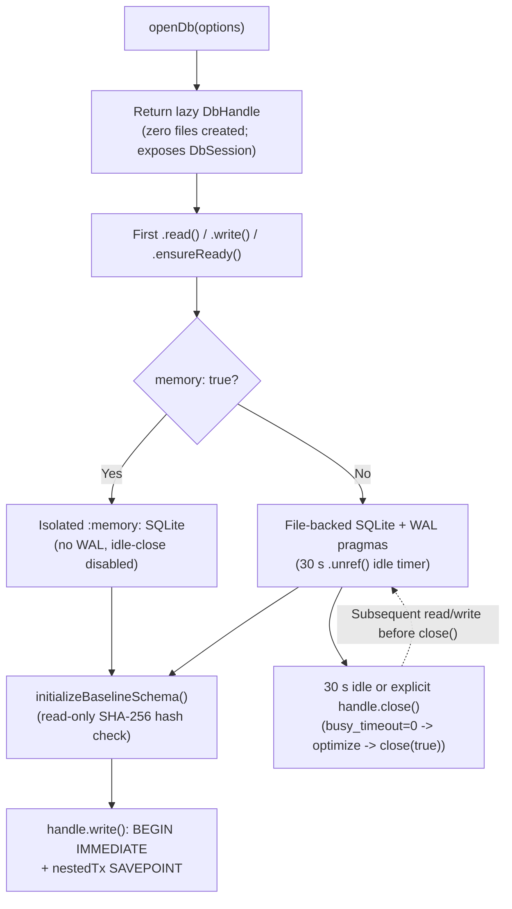

# Persistence and database architecture

Embedded SQLite foundation, `DbSession` vs. `DbHandle` ownership, automatic idle-close, WAL concurrency, lazy schema initialization, and multi-environment path resolution for `packages/db`.

## Module responsibilities

| Path                          | Responsibility                                                                                                     | Entrypoint                          |
| :---------------------------- | :----------------------------------------------------------------------------------------------------------------- | :---------------------------------- |
| `packages/db/drizzle/`        | Versioned Drizzle SQL migration files and `meta/_journal.json`.                                                    | Statically bundled by `migrator.ts` |
| `packages/db/src/schema/`     | Drizzle tables (`system.ts` for `system_metadata`, `lighthouse.ts` for `lighthouse_runs`, `schema.ts` aggregator). | `packages/db/src/schema/schema.ts`  |
| `packages/db/src/client.ts`   | Lazy `openDb` (`DbSession` / `DbHandle`), 30 s idle-close, `BEGIN IMMEDIATE`, savepoints.                          | `packages/db/src/index.ts`          |
| `packages/db/src/config.ts`   | Multi-environment path resolution (`resolveDatabaseTargetPath`, `resolveDatabasePath`).                            | `packages/db/src/index.ts`          |
| `packages/db/src/migrator.ts` | Bundled SHA-256 SQL lazy schema initialization (`initializeBaselineSchema`, `EMBEDDED_SQL_BY_TAG`).                | `packages/db/src/index.ts`          |

## Lazy handle ownership and idle-close lifecycle

- **Ownership split (`DbSession` vs. `DbHandle`).** `openDb()` returns an owner-only `DbHandle` (exposing `close()` and `[Symbol.dispose]()`) for application composition roots (`apps/cli`, `apps/api`). Feature packages such as `@devtools/lighthouse` accept only a borrowed `DbSession` (`path`, `ensureReady()`, `read()`, `write()`), preventing stores from closing caller-managed connections.
- **Lazy physical open and automatic 30 s idle-close.** File-backed handles defer opening SQLite until first access. After 30 seconds of inactivity (configurable via `idleTimeoutMs`, disabled when `0` or `:memory:`), an `.unref()`'d timer sets `PRAGMA busy_timeout = 0` so `PRAGMA optimize` skips immediately under external writers instead of stalling the event loop, then calls `sqlite.close(true)` to finalize Drizzle's uncached prepared statements and clean up `-wal` / `-shm` sidecars immediately. Later calls before explicit `handle.close()` reopen transparently (and self-heal if the file was deleted while idle).
- **Statically bundled schema and SHA-256 migration tracking.** `packages/db/src/migrator.ts` statically imports `packages/db/drizzle/*.sql` (`with { type: "text" }`) and `drizzle/meta/_journal.json` (`with { type: "json" }`) so compiled single-file binaries (`dist/devtools`) initialize and upgrade tables without external SQL files on disk.
- **Idempotent first-access init and upgrades.** When `autoInit !== false`, first access checks `sqlite_master` and `__devtools_migrations` (`id INTEGER PRIMARY KEY AUTOINCREMENT`, `hash`, `created_at`) read-only without a write lock. Empty databases apply all embedded migrations inside `BEGIN IMMEDIATE`, tracked databases apply only migrations whose SHA-256 hash is missing, up-to-date databases return immediately, and foreign databases with unrelated tables and no `__devtools_migrations` table stay untouched.

## SQLite concurrency pragmas (ADR 0001)

Per [ADR 0001](../adr/0001-embedded-database-foundation.md), file-backed connections apply these pragmas on open (in-memory databases skip WAL and `synchronous`):

| Pragma         | Value    | Purpose                                                                      |
| :------------- | :------- | :--------------------------------------------------------------------------- |
| `journal_mode` | `WAL`    | Allows concurrent readers alongside one active writer without read blocking. |
| `synchronous`  | `NORMAL` | Preserves crash safety in WAL mode without per-commit `fsync` stalls.        |
| `foreign_keys` | `ON`     | Enforces referential integrity at the SQLite engine level.                   |
| `busy_timeout` | `5000`   | Waits up to 5 seconds on lock contention before raising `SQLITE_BUSY`.       |

## Multi-environment path resolution

`packages/db/src/config.ts` consumes `@devtools/core/node` (`findWorkspaceRoot`, `isStandaloneRuntime`) with injectable `env`, `cwd`, `memory`, `isStandalone`, and `idleTimeoutMs` configuration seams:

| Priority | Condition                                                  | Resolved target                                 |
| :------: | :--------------------------------------------------------- | :---------------------------------------------- |
|    1     | `memory: true`                                             | `:memory:`                                      |
|    2     | `customPath`, `DEVTOOLS_DB_PATH`, or `DATABASE_URL` is set | `:memory:` or path resolved from `cwd`          |
|    3     | `NODE_ENV === "test"` or `BUN_ENV === "test"`              | `:memory:`                                      |
|    4     | `isStandaloneRuntime()` or `NODE_ENV === "production"`     | `~/.devtools/devtools.db`                       |
|    5     | Local workspace development (fallback)                     | `<workspace_root or cwd>/.devtools/devtools.db` |

> [!TIP]
> Pass `openDb({ memory: true })` in tests for isolated in-memory databases with zero disk I/O and explicit `using` / `.close()` cleanup.

For the 3-tier `lighthouse_runs` schema implemented in `packages/db/src/schema/lighthouse.ts`, see [Performance auditing architecture](lighthouse.md#3-tier-storage-architecture).
