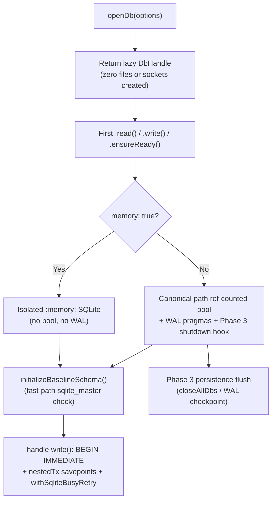

# Persistence and database architecture

Embedded SQLite foundation, Database Handle Pool, WAL concurrency, Lazy Schema Initialization, and Multi-Environment Path Resolution for `packages/db`.

## Module responsibilities

| Path                          | Responsibility                                                                             | Entrypoint                          |
| :---------------------------- | :----------------------------------------------------------------------------------------- | :---------------------------------- |
| `packages/db/drizzle/`        | Versioned Drizzle SQL migration files and `meta/_journal.json`.                            | Statically bundled by `migrator.ts` |
| `packages/db/src/schema/`     | Drizzle tables (`system.ts` for `system_metadata`, `lighthouse.ts` for `lighthouse_runs`). | `packages/db/src/schema/index.ts`   |
| `packages/db/src/client.ts`   | Lazy `openDb` Database Handle Pool, `SQLITE_BUSY` retry, `BEGIN IMMEDIATE`, shutdown hook. | `packages/db/src/index.ts`          |
| `packages/db/src/config.ts`   | Multi-Environment Path Resolution (`resolveDatabaseTargetPath`, `resolveDatabasePath`).    | `packages/db/src/index.ts`          |
| `packages/db/src/migrator.ts` | Bundled SQL Lazy Schema Initialization (`initializeBaselineSchema`).                       | `packages/db/src/index.ts`          |

## Lazy pooled handle lifecycle

- **Statically bundled schema.** `packages/db/src/migrator.ts` statically imports `packages/db/drizzle/*.sql` (`with { type: "text" }`) and `drizzle/meta/_journal.json` (`with { type: "json" }`) so compiled single-file binaries (`dist/devtools`) initialize tables without external SQL files on disk.
- **Idempotent first-access init.** When `autoInit !== false`, first access checks `sqlite_master` (`userTableCount === 0` fast-path) and applies the baseline schema plus `__devtools_migrations` ledger inside an immediate write transaction.
- **Shutdown ordering.** File-backed pooled handles self-register on `ShutdownRegistry` Phase 3 (`persistence`) so SQLite closes only after HTTP `ingress` and background `work` finish.

## SQLite concurrency pragmas (ADR 0001)

Per [ADR 0001](../adr/0001-embedded-database-foundation.md), file-backed connections apply these pragmas on open (in-memory databases skip WAL):

| Pragma         | Value    | Purpose                                                                      |
| :------------- | :------- | :--------------------------------------------------------------------------- |
| `journal_mode` | `WAL`    | Allows concurrent readers alongside one active writer without read blocking. |
| `synchronous`  | `NORMAL` | Preserves crash safety in WAL mode without per-commit `fsync` stalls.        |
| `foreign_keys` | `ON`     | Enforces referential integrity at the SQLite engine level.                   |
| `busy_timeout` | `5000`   | Waits up to 5 seconds on lock contention before raising `SQLITE_BUSY`.       |

## Multi-Environment Path Resolution (ADR 0002)

`packages/db/src/config.ts` consumes `@devtools/core/node` (`findWorkspaceRoot`, `isStandaloneRuntime`) with injectable `env`, `cwd`, `memory`, and `isStandalone` Configuration Seams:

| Priority | Condition                                                  | Resolved target                                 |
| :------: | :--------------------------------------------------------- | :---------------------------------------------- |
|    1     | `memory: true`                                             | `:memory:`                                      |
|    2     | `customPath`, `DEVTOOLS_DB_PATH`, or `DATABASE_URL` is set | `:memory:` or path resolved from `cwd`          |
|    3     | `NODE_ENV === "test"` or `BUN_ENV === "test"`              | `:memory:`                                      |
|    4     | `isStandaloneRuntime()` or `NODE_ENV === "production"`     | `~/.devtools/devtools.db`                       |
|    5     | Local workspace development (fallback)                     | `<workspace_root or cwd>/.devtools/devtools.db` |

> [!TIP]
> Pass `openDb({ memory: true })` (or `openLighthouseStore({ memory: true })`) in tests for isolated in-memory databases with zero disk I/O and zero cross-test pool sharing.

For the 3-tier `lighthouse_runs` schema implemented in `packages/db/src/schema/lighthouse.ts`, see [Performance auditing architecture](lighthouse.md#3-tier-storage-architecture).
