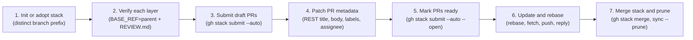

# Stacked pull requests

Workflow for decomposing large or multi-layer changesets into an ordered chain of dependent branches and pull requests (`main <- layer-1 <- layer-2 <- ... <- layer-N`) using GitHub's `gh-stack` extension. For shared title, template, label, and evidence rules, see [Pull requests](../pull-request.md).



## 1. Layering and isolation rules

Stack pull requests when a changeset exceeds **5,000 LOC** or **80 modified files**, or spans multiple architectural tiers:

1. **Layer 1 (foundation, tooling, or schemas).** Core types, database schemas, scripts, or CI configs.
2. **Layer 2 (shared packages).** Domain logic, shared libraries, and runtime seams.
3. **Layer 3 (backend applications).** API routes, CLI commands, or Daemon endpoints.
4. **Layer 4 (frontend or documentation).** Web UI components, Portable Stories, or cross-cutting repository docs (`docs/**`, root `*.md`, and `.agents/**` belong in their own top layer rather than inside a `cli` or `api` layer).

Name stack branches using a distinct prefix to prevent Git ref prefix collisions per [Creating and naming branches](../branches.md#creating-and-naming-branches).

## 2. Prerequisites, git config, and non-interactive safety

Install `gh-stack` (`v0.3.0+`) and apply the one-time settings in [Local Git setup](../branches.md#local-git-setup):

```bash
gh extension install github/gh-stack
```

In non-interactive shells, export `GH_STACK_NO_UPDATE_NOTIFIER=1` and run `gh stack <command> --help` (not `gh stack help <command>`). Many `gh stack` commands open TUIs when a PTY is attached even with `PAGER=cat`; always use these safe forms:

| Command            | Safe non-interactive form                                        | Avoid                                          | Reason                                                                                                        |
| :----------------- | :--------------------------------------------------------------- | :--------------------------------------------- | :------------------------------------------------------------------------------------------------------------ |
| View stack         | `gh stack view --json` or `gh stack view --short`                | `gh stack view`, `gh stack status`             | Bare `view` opens an interactive TUI; `status` does not exist.                                                |
| Initialize stack   | `gh stack init [--base main] <branch>...`                        | `gh stack init`, `gh stack adopt`              | Bare `init` prompts interactively; `init` adopts existing branches (`--adopt` is deprecated).                 |
| Add branch         | `gh stack add <branch>` or `gh stack add -A -m "<msg>" <branch>` | `gh stack add` or `-m` without `<branch>`      | Omitting `<branch>` prompts interactively or creates `MM-DD-slug` names.                                      |
| Switch branch      | `gh stack checkout <target>` or `up` / `down` / `top` / `bottom` | `gh stack checkout`, `gh stack switch`         | Bare `checkout` and `switch` open interactive menus.                                                          |
| Submit PRs         | `gh stack submit --auto` then `gh stack submit --auto --open`    | Bare `gh stack submit`                         | Bare `submit` opens a TUI editor.                                                                             |
| Sync stack         | `gh stack sync --prune [--accept-base-change]`                   | `gh stack sync`, `gh stack clean`              | Bare `sync` prompts to prune merged branches; `clean` does not exist.                                         |
| Restructure stack  | `gh stack unstack [--local]` + Git + `gh stack init`             | `gh stack modify`, `gh stack untrack`, `split` | `modify` is TUI-only (except `--continue` / `--abort`); `untrack` and `split` do not exist.                   |
| Merge stack        | `gh stack merge [<stack> \| <pr>] --yes --squash`                | `gh pr merge`                                  | `gh pr merge` fails on stacked PRs; confirm readiness before passing `--yes`.                                 |
| Commit changes     | `git commit -m "..."` (with `lefthook.yml` hooks)                | `git commit --no-verify`                       | Hooks enforce formatting, secret scanning, and Conventional Commit format.                                    |
| Inspect / edit PRs | `gh pr view <pr> --json ...` and `gh api --method PATCH ...`     | Bare `gh pr view`, `gh pr edit`                | `gh 2.46.0` fails on deprecated `projectCards` GraphQL queries unless bypassed via `--json` or REST `gh api`. |

### Exit codes (`gh-stack`)

|       Code | Meaning                                                      | Action                                                              |
| ---------: | :----------------------------------------------------------- | :------------------------------------------------------------------ |
|        `0` | Success or non-interactive divergence abort (`Sync aborted`) | Verify output before assuming `sync` completed.                     |
|        `2` | Current branch is not part of a stack                        | Run `gh stack checkout <pr_number>` or `gh stack link`.             |
|        `3` | Rebase conflict                                              | Resolve conflicts and run `gh stack rebase --continue` (`--abort`). |
|        `6` | Branch belongs to multiple stacks                            | Pass an explicit stack number, PR number, or PR URL.                |
| `7` / `10` | Interrupted `rebase` or `modify` session                     | Run `--continue` or `--abort` on the interrupted command.           |
|        `8` | Clone-wide stack operation lock held                         | Finish or abort active operations in sibling worktrees first.       |
|        `9` | Repository lacks GitHub Stacked PRs support                  | Verify repository settings before continuing.                       |

## 3. Creating, verifying, and submitting a stack

### Step 1: Initialize and populate layers

Build forward from trunk (run `gh stack add` only from trunk or the topmost stack branch):

```bash
gh stack init 102-audit/01-schemas-and-core
# Commit logical changes per ../commits.md
gh stack add 102-audit/02-lighthouse-runner
```

Or adopt pre-split branches bottom-to-top (leaving the topmost branch checked out):

```bash
gh stack init --base main \
  102-audit/01-schemas-and-core \
  102-audit/02-lighthouse-runner \
  102-audit/03-cli-commands
gh stack view --json
```

Never open a late layer standalone with `gh pr create`; use `gh stack add <branch>` + `gh stack submit --auto` (or attach an existing PR with `gh stack link <stack-number> <pr-number>`).

### Step 2: Verify each layer against its base

Set `BASE_REF="<parent-layer-branch>"` (`origin/main` once lower layers merge) when verifying a layer per [`REVIEW.md`](../../../REVIEW.md). Confirm the top layer matches the original pre-split branch with zero diff (`git diff <original-branch>..<top-layer>`), and re-verify upper layers whenever a lower branch changes.

### Step 3: Submit drafts first, then patch metadata

Submit stacked PRs in two phases because `gh stack submit --auto` falls back to humanized branch names on multi-commit layers, copies [`.github/PULL_REQUEST_TEMPLATE.md`](../../../.github/PULL_REQUEST_TEMPLATE.md) verbatim, lacks `--label`/`--assignee`, and never updates existing titles or bodies:

1. **Create draft PRs** (pass `--no-atomic` or `GH_STACK_NO_ATOMIC=1` if atomic multi-branch push hits ref-update limits):
   ```bash
   gh stack submit --auto
   ```
2. **Patch title, body, labels, and assignee bottom-to-top** per [Shared pull request rules](../pull-request.md#shared-pull-request-rules), computing each title from that layer's own cumulative diff and using `Part of #<issue>` on intermediate layers (`Closes #<issue>` on the top layer only):
   ```bash
   GH_LOGIN="$(gh api user --jq .login)"
   gh api --method PATCH "repos/{owner}/{repo}/pulls/<pr_number>" -f title="<title>" -F body=@<body_file>
   gh api --method POST "repos/{owner}/{repo}/issues/<pr_number>/labels" -f "labels[]=<area-label>" -f "labels[]=<type-label>"
   gh api --method POST "repos/{owner}/{repo}/issues/<pr_number>/assignees" -f "assignees[]=$GH_LOGIN"
   ```
3. **Mark all layers ready for review:**
   ```bash
   gh stack submit --auto --open
   ```

## 4. Updating, rebasing, and syncing

### Modifying a lower layer

1. Switch via `gh stack checkout <branch>`, commit fixes, and verify the layer.
2. Cascade-rebase upper branches (omit `--no-trunk` to include trunk):
   ```bash
   gh stack rebase --upstack --no-trunk
   ```
   On conflicts, resolve files, run `git add <files>`, then `gh stack rebase --continue` (or `--abort`).
3. Fetch and push (`gh stack push` does not auto-fetch before `--force-with-lease`):
   ```bash
   git fetch origin && gh stack push
   ```
   Multi-branch pushes trigger two `synchronize` webhooks on upper PRs (`github/gh-stack#628`); workflow concurrency cancels the first run and completes the second, so re-check CI if the first status shows cancelled.
4. Reply to review comments only **after** pushing per [Pull request comments](comments.md).

### Syncing after partial merges and recovery

Run `gh stack sync --prune` after lower layers squash-merge to advance `main`, `--onto`-rebase remaining layers, push updated refs, and prune merged local branches.

| Symptom                                                  | Cause                                                    | Recovery                                                                                                                                              |
| :------------------------------------------------------- | :------------------------------------------------------- | :---------------------------------------------------------------------------------------------------------------------------------------------------- |
| `Sync aborted` with exit `0`                             | Local and remote stacks diverged non-interactively       | Compare `gh stack view --json` with remote PRs and run the matching local-truth or remote-truth reset below.                                          |
| `sync` exits `3` and restores branches                   | Rebase conflict during automatic `sync`                  | Run `gh stack rebase` to resolve conflicts step by step, then `git fetch origin && gh stack push`.                                                    |
| Base changed warning on `sync` or `rebase`               | GitHub retargeted PR base after unmerged branch deletion | Pass `--accept-base-change` if dropping old base commits is intended.                                                                                 |
| `current branch "..." is not part of a stack` (`exit 2`) | Local tracking missing or stale across merges            | Run `gh stack unstack --local && gh stack checkout <pr_number>` when the remote stack is truth.                                                       |
| Unstacked PR created via `gh pr create`                  | Branch was pushed outside `gh stack submit`              | Run `gh stack link <stack-number> <pr_number>` (`HTTP 422` warnings on already-merged layers are benign).                                             |
| Local branches differ from remote stack                  | Rebuilt stack locally or split layers after creation     | Run `gh stack unstack && gh stack init --base main <b1> <b2> ... && gh stack submit --auto`.                                                          |
| Lower PR merged but next PR targets old branch           | Remote base did not retarget `main` cleanly              | Run `gh stack unstack`, `gh api --method PATCH repos/{owner}/{repo}/pulls/<pr> -f base=main`, `gh stack sync --prune`, then `gh stack submit --auto`. |

## 5. Merging and cleanup

> [!WARNING]
> Stacked pull requests cannot use `gh pr merge`, do not support `--auto` merge-when-ready, and cannot bypass `Protect Main Branch` rulesets. Confirm every layer up to the target has `CODEOWNERS` approval (`0` changes requested), all review threads resolved, and all required status checks passing (`gh pr checks <pr_number>`) before merging.

```bash
gh stack view --json
gh stack merge [<stack-number> | <pr-number>] --yes --squash
```

- Because a bare number matches a **stack number** first and then a **PR number**, passing a PR number that matches an active stack number selects that other stack without confirmation under `--yes`. Verify the target stack and merge set with `gh stack view --json` first, and omit the number when checked out on the target stack (or confirm no stack number matches `<pr-number>`) before passing `--yes`. Passing `<pr-number>` squash-merges that PR and every unmerged layer below it.
- Release Please evaluates each squashed PR title landed on `main`.
- Clean up local and any pre-split tracking branches afterward:
  ```bash
  git checkout main && git pull && gh stack sync --prune
  ```
  Delete any leftover initial tracking branch locally (`git branch -D <branch>`) and remotely (`gh api --method DELETE repos/{owner}/{repo}/git/refs/heads/<branch>`), or audit all stale branches per [Branches](../branches.md#auditing-and-cleaning-up-stale-branches).
