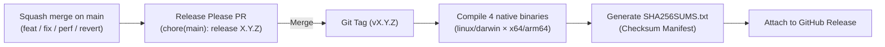

# Releases and distribution

Automated semantic versioning via Google Release Please and standalone binary distribution via GitHub Actions.

## Release Please version triggers

Configured in [`release-please-config.json`](../../release-please-config.json):

| Commit prefix on `main`                                            | Release impact        | Notes                                                                                               |
| :----------------------------------------------------------------- | :-------------------- | :-------------------------------------------------------------------------------------------------- |
| `fix:`, `perf:`, `revert:`                                         | Patch (`v0.0.X`)      | Included in changelog.                                                                              |
| `feat:`                                                            | Minor (`v0.X.0`)      | Included in changelog.                                                                              |
| `feat!:` (or `<type>!:` / `BREAKING CHANGE:`)                      | Major (`vX.0.0`)      | Triggers major bump regardless of type. Prefer `!:` in the PR title since squash bodies stay empty. |
| `chore:`, `ci:`, `docs:`, `style:`, `refactor:`, `test:`, `build:` | None (`hidden: true`) | Hidden from changelog unless accompanied by a breaking change.                                      |

Commits modifying only excluded paths (`.agents`, `.github`, `docs`, `scripts`, `site`) are ignored by Release Please (`exclude-paths`).

## Release pull request workflow

Release Please maintains an open release pull request (`chore(main): release X.Y.Z`). Merging it into `main` triggers [`.github/workflows/release.yml`](../../.github/workflows/release.yml) to:

1. Create the Git release tag.
2. Compile standalone native binaries for four targets: `devtools-linux-x64`, `devtools-linux-arm64`, `devtools-darwin-x64`, and `devtools-darwin-arm64`.
3. Compute the `SHA256SUMS.txt` Checksum Manifest.
4. Publish the binaries and Checksum Manifest to the GitHub Release.
