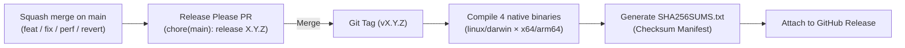

# Releases and distribution

Automated semantic versioning via Google Release Please and standalone binary distribution via GitHub Actions.

## Release Please version triggers

Configured in [`release-please-config.json`](../../release-please-config.json):

| Commit prefix on `main`                                            | Release impact        | Notes                                                                                                                                                    |
| :----------------------------------------------------------------- | :-------------------- | :------------------------------------------------------------------------------------------------------------------------------------------------------- |
| `fix:`, `perf:`, `revert:`                                         | Patch (`v0.0.X`)      | Included in changelog.                                                                                                                                   |
| `feat:`                                                            | Minor (`v0.X.0`)      | Included in changelog.                                                                                                                                   |
| `feat!:` (or `<type>!:` / `BREAKING CHANGE:`)                      | Major (`vX.0.0`)      | Triggers major bump on subsequent releases (`0.1.0` initial release uses `initial-version`). Prefer `!:` in the PR title since squash bodies stay empty. |
| `chore:`, `ci:`, `docs:`, `style:`, `refactor:`, `test:`, `build:` | None (`hidden: true`) | Hidden from changelog unless accompanied by a breaking change.                                                                                           |

Commits modifying only excluded paths (`.agents`, `.github`, `docs`, `scripts`, `site`) are ignored by Release Please (`exclude-paths`).

## Release pull request workflow

Release Please maintains an open release pull request (`chore(main): release X.Y.Z`). Merging it into `main` triggers [`.github/workflows/release.yml`](../../.github/workflows/release.yml) to:

1. Create the Git release tag.
2. Compile standalone native binaries for four targets: `devtools-linux-x64`, `devtools-linux-arm64`, `devtools-darwin-x64`, and `devtools-darwin-arm64`.
3. Compute the `SHA256SUMS.txt` Checksum Manifest.
4. Publish the binaries and Checksum Manifest to the GitHub Release.

## Milestones and release cadence

Milestones are public shipping commitments rather than backlog folders. Each milestone defines what must finish before cutting a release, while unmilestoned issues form the backlog.

### Naming and cadence

Name each milestone after its user-facing theme or deliverable (such as `Core & Lighthouse` or `Image Compression`) rather than a SemVer number, since Release Please determines the actual release version from merged commits. Only include a version when the version itself is an explicit stability commitment (such as a `v1.0.0` stability gate). Avoid vague or permanent bucket names such as `MVP`, `Phase 2`, `Polish`, `Backlog`, or `Future`.

Follow a sequential **Now, Next, Horizon** cadence:

| Slot        | Limit           | Purpose                                                                      |
| :---------- | :-------------- | :--------------------------------------------------------------------------- |
| **Now**     | 1 active        | The single upcoming release driven to completion.                            |
| **Next**    | 1 planned       | The next minor release, used to hold deferred scope from `Now`.              |
| **Horizon** | 0 or 1 optional | A long-term target such as `v1.0.0` for breaking changes or stability gates. |

Avoid running parallel feature milestones. Only run parallel milestones when maintaining a stable release line (such as `v1.0.x`) alongside the next minor or major release.

### Scope and progress rules

- **Target one major capability per milestone.** Keep releases small and frequent rather than bundling unrelated tools into one launch.
- **State boundaries in the description.** Include explicit in-scope and out-of-scope lines so new requests have a clear bar for entry.
- **Treat due dates as scope-cut dates.** Omit due dates when shipping strictly by scope. If a due date is set, move unfinished items to `Next` on that date instead of leaving the milestone overdue.
- **Keep internal work out of release milestones.** Leave CI, developer tooling, documentation cleanups, and retrospective tasks unmilestoned unless they directly block shipping that release.
- **Assign milestones at Spec granularity only.** Assigning milestones only to parent Specs (per [Issue tracking and management](issues.md#specs-vs-tickets)) keeps the GitHub progress bar accurate.

### How milestones pair with Release Please

Milestones and Release Please handle two separate halves of shipping, and Release Please does not read GitHub Milestones. Keeping milestones theme-only avoids version drift when Release Please bumps versions from merged commits:

| Mechanism            | Direction                  | Trigger                                     | Answers                                                                 |
| :------------------- | :------------------------- | :------------------------------------------ | :---------------------------------------------------------------------- |
| **GitHub Milestone** | Forward-looking planning   | Maintainer assigns Specs                    | What must finish before we cut the next release?                        |
| **Release Please**   | Backward-looking packaging | Merged `feat:` and `fix:` commits on `main` | Given what landed on `main`, what is the next SemVer tag and changelog? |

Merging `feat:` and `fix:` pull requests accumulates entries inside one open Release Please pull request (`chore(main): release X.Y.Z`) until the maintainer merges that pull request and closes the matching milestone. Keep three Release Please behaviors in mind when planning milestones:

1. **Patch releases (`vX.Y.Z+1`) from `main`.** A `fix:` commit creates a patch Release PR only before the first `feat:` for the next minor merges to `main`.
2. **Pre-1.0 breaking changes (`feat!:`).** Without `bump-minor-pre-major` enabled in [`release-please-config.json`](../../release-please-config.json), a breaking-change commit during `0.x` jumps the open Release PR to `1.0.0`.
3. **Manual version overrides.** Graduating to `v1.0.0` without a breaking change uses a `Release-As: 1.0.0` commit footer.
